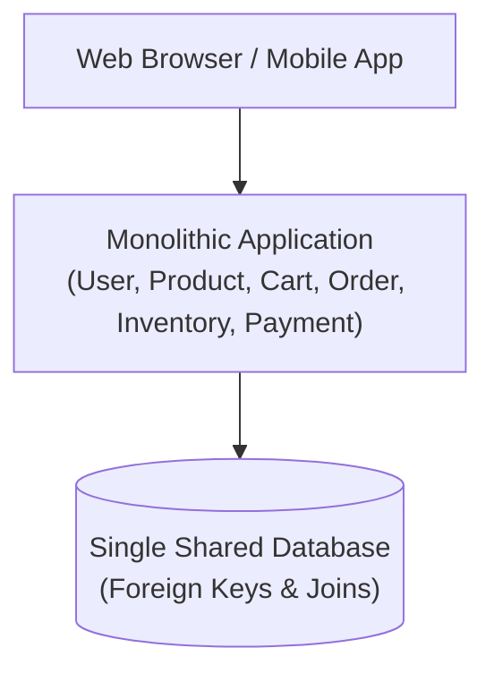
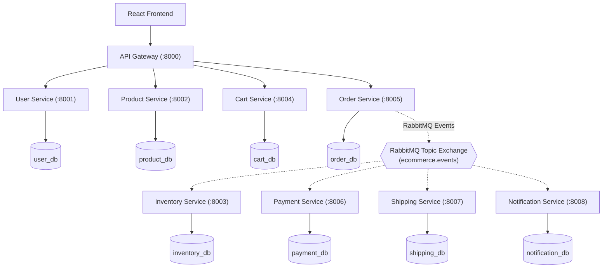
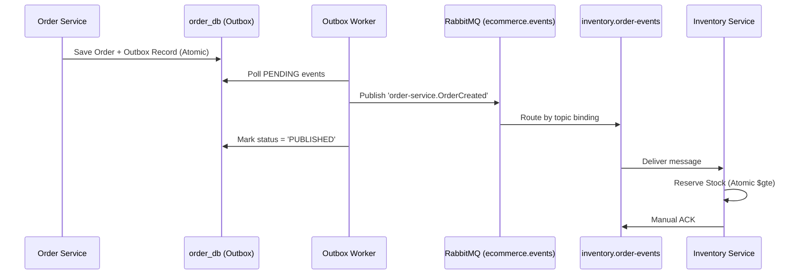
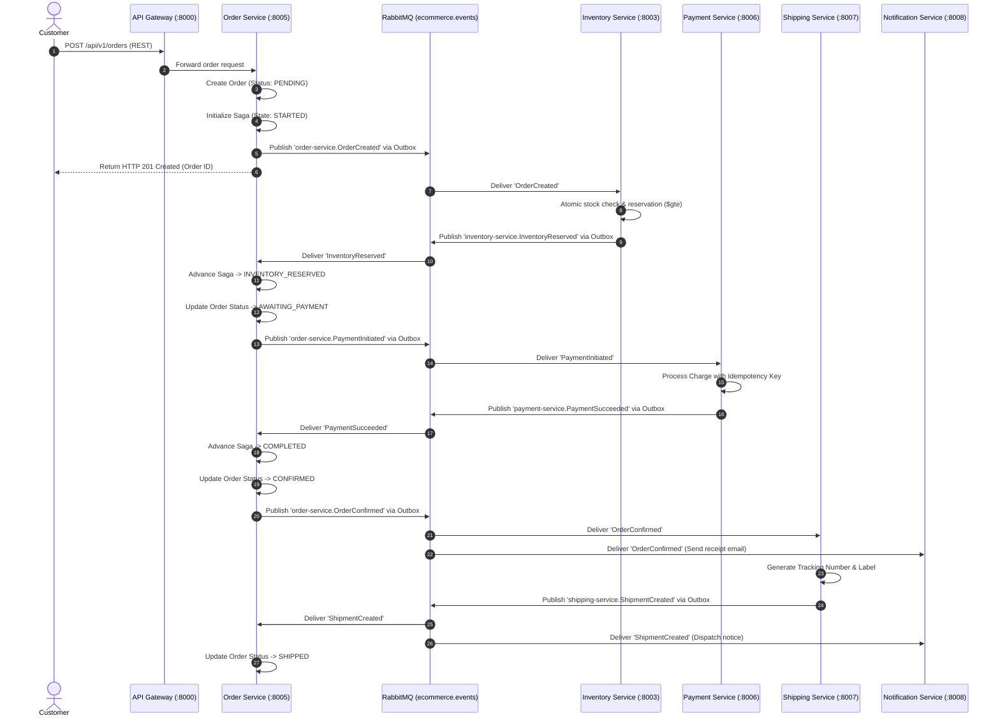
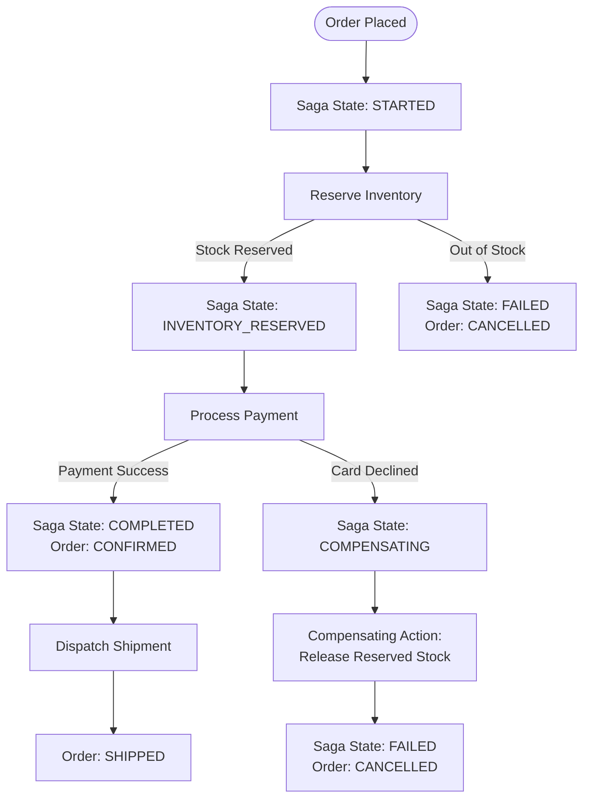
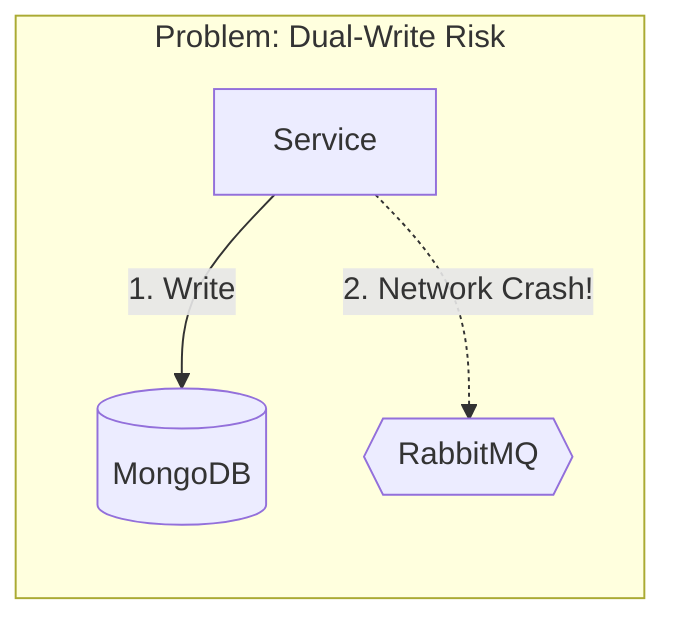
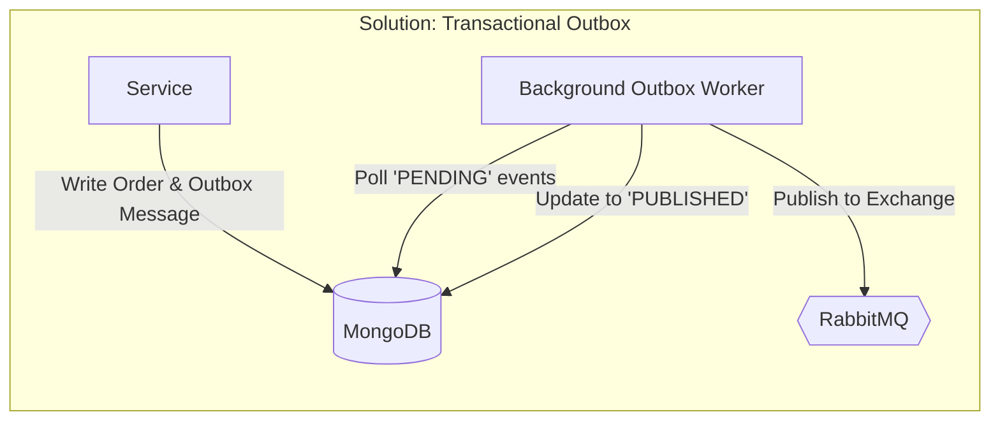
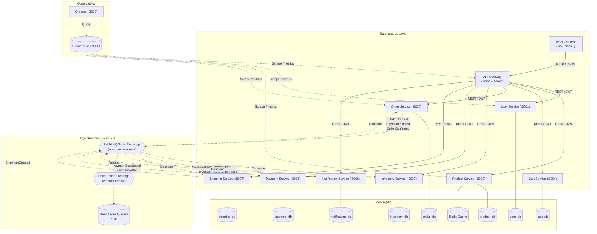

# OmniStore: A Comprehensive Microservices Architecture Learning Guide

OmniStore is an open-source, production-grade e-commerce application designed specifically as an **educational blueprint for learning Microservices Architecture**.

Instead of abstract theory, OmniStore demonstrates how modern distributed systems are architected, developed, communicated, orchestrated, tested, secured, and deployed using realistic business workflows.

---

## Table of Contents

- [1. Introduction](#1-introduction)
- [2. Monolithic Architecture vs. Microservices Architecture](#2-monolithic-architecture-vs-microservices-architecture)
- [3. Understanding Microservices Through OmniStore](#3-understanding-microservices-through-omnistore)
- [4. Database-per-Service Pattern](#4-database-per-service-pattern)
- [5. How Microservices Communicate](#5-how-microservices-communicate)
  - [A. Synchronous Communication (REST APIs)](#a-synchronous-communication-rest-apis)
  - [B. Asynchronous Communication (RabbitMQ Event Broker)](#b-asynchronous-communication-rabbitmq-event-broker)
  - [C. REST vs. RabbitMQ: Architectural Decision Matrix](#c-rest-vs-rabbitmq-architectural-decision-matrix)
- [6. Real E-Commerce Order Workflow](#6-real-e-commerce-order-workflow)
- [7. What Happens When Something Fails?](#7-what-happens-when-something-fails)
- [8. Distributed Transactions and the Saga Pattern](#8-distributed-transactions-and-the-saga-pattern)
- [9. Transactional Outbox Pattern](#9-transactional-outbox-pattern)
- [10. Idempotency and Concurrency Management](#10-idempotency-and-concurrency-management)
- [11. Independent Deployment and Scaling](#11-independent-deployment-and-scaling)
- [12. Security Across Service Boundaries](#12-security-across-service-boundaries)
- [13. CI/CD for Independent Microservices](#13-cicd-for-independent-microservices)
- [14. Monitoring and Observability](#14-monitoring-and-observability)
- [15. Complete Project Architecture Diagram](#15-complete-project-architecture-diagram)
- [16. Hands-on Learning Guide (18 Step-by-Step Exercises)](#16-hands-on-learning-guide-18-step-by-step-exercises)
- [17. Running the Project Locally](#17-running-the-project-locally)
- [18. Testing Strategy & Verification Suites](#18-testing-strategy--verification-suites)
- [19. Advantages and Real-World Challenges of Microservices](#19-advantages-and-real-world-challenges-of-microservices)
- [20. Important Microservices Terminology (Glossary)](#20-important-microservices-terminology-glossary)

---

## 1. Introduction

### What is OmniStore?
OmniStore is a fully functional, event-driven e-commerce platform built with **Python (FastAPI)**, **MongoDB**, **RabbitMQ**, **Redis**, **React + TypeScript**, **Docker**, and **Kubernetes**.

### Why Was This Project Built?
Most online microservices tutorials are toy examples: they either build two trivial services communicating over HTTP or explain theory with slide decks. Real-world microservices require solving hard distributed systems problems:
- *What happens when a network request drops halfway through an order?*
- *How do you prevent double-charging a customer on network retries?*
- *How do you maintain data consistency across databases without distributed locking?*
- *How do services scale and deploy independently without breaking each other?*

OmniStore was built to provide an **executable, observable, and verifiable reference implementation** answering these questions.

### What is Microservices Architecture?
> **Definition:** Microservices is an architectural approach where a large application is divided into smaller, independently deployable services. Each service handles a specific business responsibility and communicates with other services through well-defined interfaces.

In simple terms:
Instead of writing a single massive program containing all your business logic, user management, checkout code, warehouse management, and billing in one file tree and one database, you build smaller, focused programs.
- One program manages user accounts.
- One program tracks product listings.
- One program manages warehouse inventory.
- One program coordinates customer checkouts.

Each program runs in its own process, connects to its own database, and communicates across the network using standard protocols.

### What Problems Does Microservices Architecture Solve?
1. **Team Bottlenecks:** Multiple autonomous teams can build, test, and release services on their own schedules without coordinating monolithic deployments.
2. **Selective Scalability:** If checkout traffic spikes during Black Friday, you scale up only the `order-service` and `inventory-service` instead of scaling the entire monolithic application stack.
3. **Fault Isolation:** If the notification or recommendation engine crashes, customers can still browse products, place orders, and pay.
4. **Technology Flexibility:** Different services can adopt different databases, libraries, or runtimes suited for their specific domain.

---

## 2. Monolithic Architecture vs. Microservices Architecture

### Monolithic Architecture
A monolithic architecture is defined by its **unified deployment model**: all components, modules, and business capabilities of the application are coupled into a single unit that must be built, tested, and released together. A monolith is not strictly defined by whether it runs as a single operating system process or connects to a single database—a monolithic application may consist of multiple processes, background workers, or multi-tier servers—but rather by the fact that changes to any component necessitate rebuilding, validating, and deploying the application as a unified release unit.

### Microservices Architecture
In microservices, the system is decomposed along business domain boundaries (Bounded Contexts). Each microservice is an autonomous software artifact with its own runtime dependencies, dedicated continuous integration pipeline, independent release cadence, and private database.

#### Repository Strategies: Monorepo vs. Multi-Repo
Microservices architecture defines independent service boundaries at runtime and deployment, but is neutral regarding code repository structure. Teams can organize microservices using either approach:
- **Monorepo (Single Repository):** All microservices reside in one shared Git repository (as OmniStore does). This simplifies cross-cutting refactoring, shared library management (`packages/common`), contract versioning, and local developer setup, while path-filtered CI workflows (`.github/workflows/`) build and test each service independently based on file changes.
- **Multi-Repo (Multiple Repositories):** Each microservice has its own dedicated Git repository with independent version history and access control. This enforces strict isolation between engineering teams, but requires formal package versioning and artifact registries (e.g., PyPI) for shared code.

### Comparison Matrix

| Architectural Dimension | Monolithic Architecture | Microservices Architecture (OmniStore) |
|---|---|---|
| **Code Organization** | Single codebase, shared utility folders | Decoupled services (can use monorepo or multi-repo) |
| **Database Ownership** | Shared central database with foreign keys | Database-per-service (`user_db`, `order_db`, etc.) |
| **Deployment** | All-or-nothing release cycle | Independent rolling deployments (safe zero-downtime requires backward-compatible contracts and probes) |
| **Scaling** | Scale whole monolith vertically/horizontally | Granular horizontal scaling per service bottleneck |
| **Fault Isolation** | Memory leak or crash takes down entire app | Failure in one service does not halt other services |
| **Data Consistency** | ACID transactions via single database engine | Eventual consistency via Saga orchestration |
| **Communication** | In-memory function calls | Network calls (REST HTTP) & asynchronous messaging (AMQP) |
| **Operational Overhead** | Low (single server/container) | High (orchestration, service discovery, distributed tracing) |

### Visualizing the Architectures

#### Monolithic Architecture Flow


#### Microservices Architecture Flow (OmniStore)


### When Should You Choose Microservices?
- **Choose a Monolith when:** You are building an early-stage product or MVP, have a small team (under 10 engineers), domain boundaries are rapidly evolving, or operational simplicity is paramount.
- **Choose Microservices when:** You have multiple distinct engineering teams, specific modules have drastically different scaling profiles, services have independent regulatory or compliance needs, or parts of the application require independent release cadences.

---

## 3. Understanding Microservices Through OmniStore

OmniStore splits e-commerce operations into **nine distinct components** (eight business microservices plus an API Gateway):

### Service Catalog & Boundary Summary

| Service | Port | Database | Primary Business Responsibility |
|---|---|---|---|
| **API Gateway** | `8000` / `30080` | *None* | Single entry point, reverse proxy, JWT validation, rate limiting, and correlation IDs |
| **User Service** | `8001` | `user_db` | User registration, Argon2id password hashing, JWT token issuance, and RBAC |
| **Product Service** | `8002` | `product_db` | Product catalog CRUD, categories, search, and Redis cache-aside read acceleration |
| **Inventory Service** | `8003` | `inventory_db` | Real-time stock levels, atomic reservation, overselling protection, and restock audit |
| **Cart Service** | `8004` | `cart_db` | Shopping cart lifecycle, isolated per customer token, subtotal calculations |
| **Order Service** | `8005` | `order_db` | Checkout intake, distributed Saga state machine orchestrator, and compensation control |
| **Payment Service** | `8006` | `payment_db` | Sandbox credit card processing, idempotency replay protection, and card data masking |
| **Shipping Service** | `8007` | `shipping_db` | Tracking number generation, dispatch simulation, and delivery status progression |
| **Notification Service** | `8008` | `notification_db` | Asynchronous event listener, multi-event notification templates, and simulated email log |

---

### Detailed Service Breakdown

#### 1. API Gateway
- **Business Problem:** Clients (browsers, mobile apps) should not need to know the IP address, port number, or internal network topology of eight different backend microservices.
- **Data Owned:** None (Stateless reverse proxy).
- **APIs Exposed:** Proxies all `/api/v1/*` routes; provides `/health`, `/health/services` (aggregated status), and `/metrics`.
- **Communication:** Synchronous HTTP forwarding to downstream services.
- **Why Separate:** Centralizes cross-cutting concerns: CORS policies, IP rate limiting (200 req/min sliding window), request correlation tracking, and SSL termination.

#### 2. User Service
- **Business Problem:** Identity, credential security, role assignment, and user profile management.
- **Data Owned:** User accounts, password hashes (Argon2id), customer profile metadata, addresses.
- **APIs Exposed:** `POST /api/v1/auth/register`, `POST /api/v1/auth/login`, `POST /api/v1/auth/refresh`, `GET /api/v1/users/me`, `PUT /api/v1/users/me`, `POST /api/v1/users/me/addresses`.
- **Events:** None (Pure synchronous REST service; authentication & profile state managed directly).
- **Why Separate:** Identity is a security-sensitive boundary requiring high memory-cost hashing parameters and isolated access controls.

#### 3. Product Service
- **Business Problem:** Product browsing, descriptions, pricing, and category search.
- **Data Owned:** Product records (title, description, price in integer cents, category, active status).
- **APIs Exposed:** `GET /api/v1/products`, `GET /api/v1/products/{id}`, `POST /api/v1/products`, `PUT /api/v1/products/{id}`, `DELETE /api/v1/products/{id}`.
- **Events:** Emits `ProductCreated`, `ProductUpdated`, `ProductDeleted` via Transactional Outbox.
- **Caching:** Integrates Redis cache-aside (300s TTL) with automatic invalidation on catalog mutations (`X-Cache: HIT/MISS`).
- **Why Separate:** Browsing is typically read-heavy and experiences substantially higher request volumes than write-heavy checkout operations. Product Service can be aggressively cached with Redis and scaled independently without placing load on write-sensitive transactional services.

#### 4. Inventory Service
- **Business Problem:** Stock tracking and guaranteed overselling prevention under concurrent customer load.
- **Data Owned:** Stock balances (`available_quantity`, `reserved_quantity`, `sold_quantity`), restock ledgers.
- **APIs Exposed:** `GET /api/v1/inventory/{product_id}`, `POST /api/v1/inventory/reserve`, `PATCH /api/v1/inventory/{product_id}`.
- **Events:** Consumes `OrderCreated`, `OrderCancelled`, `PaymentFailed`, `OrderConfirmed`. Emits `InventoryReserved`, `InventoryReservationFailed`.
- **Why Separate:** Stock reservation requires strict atomic conditional updates (`$gte`). Isolating inventory prevents catalog browsing queries from locking or competing with reservation transactions.

#### 5. Cart Service
- **Business Problem:** Ephemeral shopping cart state while customers shop.
- **Data Owned:** Shopping cart sessions, selected items, item quantities, calculated totals.
- **APIs Exposed:** `GET /api/v1/cart`, `POST /api/v1/cart/items`, `PUT /api/v1/cart/items/{product_id}`, `DELETE /api/v1/cart/items/{product_id}`, `DELETE /api/v1/cart`.
- **Why Separate:** Carts have high churn and short lifespans. Separating cart data keeps the core order database clean and free of abandoned session bloat.

#### 6. Order Service
- **Business Problem:** Checkout coordinator, order history, and distributed Saga orchestrator.
- **Data Owned:** Orders (`orders`), Saga process state history (`saga_instances`), Outbox messages (`outbox`).
- **APIs Exposed:** `POST /api/v1/orders`, `GET /api/v1/orders`, `GET /api/v1/orders/{id}`, `GET /api/v1/orders/{id}/saga`, `POST /api/v1/orders/{id}/cancel`.
- **Events:** Emits `OrderCreated`, `PaymentInitiated`, `OrderConfirmed`, `OrderCancelled`. Consumes `InventoryReserved`, `InventoryReservationFailed`, `PaymentSucceeded`, `PaymentFailed`, `ShipmentCreated`.
- **Why Separate:** The Order Service is the heart of business state transitions. Isolating the orchestrator allows clear auditing of checkout progression and failure compensations.

#### 7. Payment Service
- **Business Problem:** Financial transaction processing, sandbox payment simulation, idempotency enforcement.
- **Data Owned:** Payment receipts, transaction ledger, idempotency records (`idempotency_keys`).
- **APIs Exposed:** `POST /api/v1/payments`, `GET /api/v1/payments/{id}`.
- **Events:** Consumes `PaymentInitiated`. Emits `PaymentSucceeded`, `PaymentFailed`.
- **Security:** Masks sensitive credit card numbers (only `card_last_four` is persisted; CVVs are never saved).
- **Why Separate:** In real-world commerce, payment processing involves strict regulatory standards (such as PCI-DSS) that require isolating cardholder data environments from general application code. OmniStore uses a simulated sandbox gateway and does not claim PCI-DSS compliance, but it models the architectural boundary separation, card data masking, and idempotency safeguards typical of dedicated payment microservices.

#### 8. Shipping Service
- **Business Problem:** Courier tracking number allocation, package dispatch simulation, tracking timeline.
- **Data Owned:** Shipment records, carrier assignments, checkpoint timelines (`ORDER_CONFIRMED` -> `LABEL_CREATED` -> `PICKED_UP` -> `IN_TRANSIT` -> `DELIVERED`).
- **APIs Exposed:** `GET /api/v1/shipments/{id}`, `GET /api/v1/shipments`, `PATCH /api/v1/shipments/{id}/status`.
- **Events:** Consumes `OrderConfirmed`. Emits `ShipmentCreated`, `ShipmentStatusUpdated`.
- **Why Separate:** Fulfillment and logistics operate on asynchronous real-world physical timelines separate from immediate digital checkout.

#### 9. Notification Service
- **Business Problem:** Omnichannel customer communication and audit history.
- **Data Owned:** Outbound message logs, notification templates, recipient audit history.
- **APIs Exposed:** `GET /api/v1/notifications`.
- **Events:** Consumes domain lifecycle events (`OrderConfirmed`, `OrderCancelled`, `PaymentFailed`, `ShipmentCreated`, `ShipmentStatusUpdated`).
- **Why Separate:** Sending emails or SMS involves slow, flaky third-party APIs. Running notifications asynchronously ensures external SMTP or SMS provider latency never delays order placement.

---

## 4. Database-per-Service Pattern

In a traditional monolithic application, any developer can write an SQL query that joins `users`, `orders`, `inventory`, and `payments` in a single query:

```sql
-- Monolithic antipattern in microservices:
SELECT * FROM orders
JOIN users ON orders.user_id = users.id
JOIN inventory ON orders.product_id = inventory.product_id;
```

In microservices, this is an **architectural antipattern**. OmniStore strictly implements the **Database-per-Service pattern**.

### Database Ownership Mapping

```
MongoDB Instance (Cluster / Pod)
├── user_db          <-- Owned EXCLUSIVELY by User Service
├── product_db       <-- Owned EXCLUSIVELY by Product Service
├── inventory_db     <-- Owned EXCLUSIVELY by Inventory Service
├── cart_db          <-- Owned EXCLUSIVELY by Cart Service
├── order_db         <-- Owned EXCLUSIVELY by Order Service
├── payment_db       <-- Owned EXCLUSIVELY by Payment Service
├── shipping_db      <-- Owned EXCLUSIVELY by Shipping Service
└── notification_db  <-- Owned EXCLUSIVELY by Notification Service
```

### Logical Database Ownership vs. Physical Infrastructure Isolation
It is crucial to distinguish between **logical database ownership** and **physical database infrastructure isolation**:

1. **Logical Database Ownership (Architectural Invariant):**
   Every microservice strictly encapsulates its domain data. No service may ever read from or write to another service's database directly. All cross-service data access must pass through well-defined APIs or asynchronous events. This boundary prevents schema coupling, protects sensitive data (e.g., credentials and payments), and ensures each service can independently evolve its internal data structures.
2. **Physical Infrastructure Isolation (Deployment & Operational Choice):**
   In enterprise production deployments, physical isolation often involves hosting databases on completely separate database clusters, managed database instances (e.g., dedicated MongoDB Atlas clusters or AWS DocumentDB instances), or different storage technologies entirely (polyglot persistence).
3. **OmniStore's Deployment Reality:**
   OmniStore configures eight distinct logical databases (`user_db`, `product_db`, `order_db`, etc.) running on a single MongoDB StatefulSet instance for local development and demonstration efficiency. This enforces **strict logical database ownership** across service code and connection strings, but does **not** provide physical infrastructure isolation (e.g., hardware resources, CPU, memory, disk I/O, and database server availability remain shared).

### Why Can't Services Share a Database?
1. **Schema Coupling:** If Service A directly reads Service B's tables, Service B can never rename or migrate a column without breaking Service A.
2. **Resource Contention:** A massive analytical query executed by the notification service could lock tables needed by the payment service.
3. **Security Boundaries:** The Product Service has no business having read or write credentials to user password hashes or payment ledgers.

### How Do Services Share Data Without Shared Databases?
- **Data by Reference:** Instead of storing complete user profile snapshots, `order-service` stores the customer's ID (`customer_id: "user-123"`) and email.
- **Domain Event Replication:** When an order is confirmed, the Order Service publishes an `OrderConfirmed` event containing the items and shipping address. The Shipping Service receives this event and saves only the fulfillment details it needs.
- **Synchronous REST Lookups:** When a customer adds an item (`POST /api/v1/cart/items`), Cart Service queries `GET /api/v1/products/{id}` via HTTP to validate the item exists and is active, and snapshot its current unit price.

### Database-per-Service vs. Multi-Collection Antipattern
Creating separate collections (`orders`, `users`) inside the **same** database is NOT genuine microservices database isolation. A shared database still shares connection pools, CPU, storage, and user credentials. OmniStore configures completely distinct logical database names and isolated connection strings for every service.

---

## 5. How Microservices Communicate

Microservices utilize two fundamentally distinct communication styles: **Synchronous REST** and **Asynchronous Messaging**.

### A. Synchronous Communication (REST APIs)

In synchronous communication, a client sends an HTTP request and **blocks/waits** until the server processes the request and returns an HTTP response.

```
Client  ──[ HTTP POST /api/v1/cart/items ]──>  API Gateway  ──[ HTTP POST ]──>  Cart Service
Client  <──[ HTTP 200 OK + JSON Cart ]─────────  API Gateway  <──[ HTTP 200 ]────  Cart Service
```

#### Real Synchronous Flow: Adding Item to Cart
1. Client sends `POST /api/v1/cart/items` with a JWT Bearer token and JSON payload:
   ```json
   { "product_id": "prod-101", "quantity": 2 }
   ```
2. API Gateway inspects the path, validates the JWT signature, injects an `X-Correlation-ID`, and proxies the request to `http://cart-service:8004/api/v1/cart/items`.
3. Cart Service extracts `user_id` from the JWT token, adds the product to `cart_db`, calculates line-item totals, and returns HTTP 200 with the serialized cart state.

#### Challenges of Synchronous REST
- **Cascading Failures:** If Service A calls Service B, which calls Service C, any slow service or network hiccup causes timeouts upstream.
- **Tight Coupling:** The caller must know the target service's hostname and port.

---

### B. Asynchronous Communication (RabbitMQ Event Broker)

In asynchronous messaging, a service produces a message and hands it off to an intermediary—the **Message Broker** (RabbitMQ). The publisher **does not wait** for other services to process the message; it returns immediately.



#### RabbitMQ Core Concepts Used in OmniStore
- **Exchange (`ecommerce.events`):** A durable `TOPIC` exchange that receives all domain events and routes them based on their routing keys.
- **Routing Key:** A dot-separated string describing the message origin and type (e.g., `order-service.OrderCreated`).
- **Queue:** A durable FIFO buffer where messages wait until consumed (e.g., `inventory.order-events`).
- **Binding:** The rule linking an exchange to a queue (e.g., bind queue `inventory.order-events` to exchange `ecommerce.events` with pattern `order-service.OrderCreated`).
- **Dead-Letter Exchange (`ecommerce.dlx`):** A safety exchange where unprocessable or rejected messages are automatically sent after maximum retries.
- **Dead-Letter Queue (`*.dlq`):** Dedicated queues (e.g., `inventory.order-events.dlq`) storing poisoned messages for manual operator investigation.
- **Manual Acknowledgment (`ACK` / `NACK`):** Consumers only acknowledge a message after business processing finishes successfully. If a pod crashes mid-execution, the unacknowledged message is returned to the queue and redelivered.

#### Standard CloudEvent Envelope
Every event published across RabbitMQ uses a standardized JSON envelope:
```json
{
  "event_id": "4238e91f-0b3c-4cf2-8354-93e1b7c8f001",
  "event_type": "OrderCreated",
  "event_version": 1,
  "aggregate_id": "ord-729425",
  "correlation_id": "c0182df3-8321-4d92-91f5-19f824719283",
  "occurred_at": "2026-11-06T16:29:33.120Z",
  "producer": "order-service",
  "payload": {
    "order_id": "ord-729425",
    "order_number": "ORD-729425",
    "customer_id": "user-cust-01",
    "total_amount": 39998,
    "items": [
      { "product_id": "prod-101", "product_name": "Headphones", "quantity": 2, "unit_price": 19999 }
    ]
  }
}
```

---

### C. REST vs. RabbitMQ: Architectural Decision Matrix

| Characteristic | Synchronous REST API | Asynchronous RabbitMQ Messaging |
|---|---|---|
| **Interaction Model** | Request / Response (1-to-1) | Publish / Subscribe (1-to-Many) |
| **Temporal Coupling** | High (both services must be online simultaneously) | Low (consumer can be offline; broker queues messages) |
| **Client Waiting Time** | Waits for processing to finish | Returns immediately after event is queued |
| **Failure Blast Radius** | Downstream latency directly impacts caller | Consumer latency does not impact caller |
| **Best Used For** | Immediate queries (fetch user profile, list products, view cart) | State change side-effects (send receipt, reserve inventory, dispatch order) |

**Golden Rule:** Use **REST** when the client requires an immediate response to render the UI. Use **RabbitMQ** when a business action triggers subsequent background workflows across multiple services.

---

## 6. Real E-Commerce Order Workflow

Here is the exact, end-to-end checkout execution path in OmniStore:



---

## 7. What Happens When Something Fails?

Distributed systems fail in complex ways. OmniStore explicitly handles the eight major distributed failure modes:

### 1. Out of Stock (Insufficient Inventory)
- **What Fails:** A customer attempts to purchase 10 units, but only 2 remain in stock.
- **Detection:** `inventory-service` executes conditional `$gte` reservation query, which matches zero documents.
- **Reaction:** Inventory Service publishes `InventoryReservationFailed`.
- **Recovery:** `order-service` consumes failure event, transitions Saga state to `FAILED`, and marks order status `CANCELLED` with reason `OUT_OF_STOCK`.

### 2. Payment Declined (Card Simulation Failure)
- **What Fails:** Customer payment fails (e.g., card declined, test failure card `0002`).
- **Detection:** `payment-service` marks payment record as `FAILED` and emits `PaymentFailed`.
- **Reaction:** `order-service` transitions Saga to `COMPENSATING` and publishes `OrderCancelled` with `inventory_release_required=True`.
- **Recovery:** `inventory-service` consumes `OrderCancelled` and increments available stock back (`$inc`), restoring stock.

### 3. RabbitMQ Broker Outage
- **What Fails:** RabbitMQ restarts or network drops temporarily.
- **Handling:** Outbox workers buffer all new events in MongoDB (`status: "PENDING"`). When RabbitMQ reconnects, outbox workers resume polling and publish buffered messages without data loss.

### 4. Consumer Pod Crash
- **What Fails:** `shipping-service` pod crashes midway through processing `OrderConfirmed`.
- **Handling:** Because manual message acknowledgment (`ack`) is only sent after database writes complete, RabbitMQ detects consumer disconnection and requeues the unacknowledged message to another running pod.

### 5. Duplicate Message Delivery
- **What Fails:** RabbitMQ redelivers an already processed payment event due to network ack timeout.
- **Handling:** `payment-service` checks its `idempotency_keys` collection. Seeing the key already processed, it returns the cached payment ID instead of creating a second charge.

### 6. Service Network Timeout
- **What Fails:** API Gateway times out waiting for Cart Service.
- **Handling:** Gateway returns HTTP 504 Gateway Timeout. Gateway in-memory sliding window protects downstream services from thundering herds.

### 7. Customer Order Cancellation
- **What Fails:** Customer calls `POST /api/v1/orders/{id}/cancel` after payment confirmation.
- **Handling:** Order Service verifies current state is cancellable (cannot cancel `SHIPPED` or `DELIVERED`). Order marked `CANCELLED`; compensating events trigger payment refund and inventory release.

### 8. Partial Reservation Failure in Multi-Item Orders
- **What Fails:** In an order with 3 items, item 1 and 2 succeed, but item 3 fails.
- **Handling:** Inventory Service detects the partial failure, rolls back the reservations for items 1 and 2, and publishes `InventoryReservationFailed`.

---

## 8. Distributed Transactions and the Saga Pattern

### Why Normal Database Transactions Don't Work Across Microservices
In a monolith, an ACID transaction wraps operations:
```python
# Monolithic ACID transaction:
with db.transaction():
    order.save()
    inventory.decrement()
    payment.charge()
```
In microservices, `orders`, `inventory`, and `payments` reside in **three separate databases**. Standard two-phase commit (2PC) protocols across microservices introduce severe network latency, table locking, and single points of failure.

### The Saga Pattern
A **Saga** is a sequence of local transactions. Each transaction updates data within a single service and publishes an event. If a step fails, the Saga coordinates **compensating transactions** that undo the changes made by preceding steps.

OmniStore implements an **Orchestrated Saga** managed by `order-service`:



---

## 9. Transactional Outbox Pattern

### The Dual-Write Problem
When a service changes database state and publishes an event, two distinct systems must be updated:
1. Save order to MongoDB (`orders.insert_one()`)
2. Publish event to RabbitMQ (`channel.basic_publish()`)

If the service crashes after step 1 but before step 2, MongoDB has the order, but RabbitMQ never receives the event. Inventory is never reserved; the order hangs forever.



### How OmniStore Solves This: Transactional Outbox
Instead of publishing directly to RabbitMQ, the service writes the event **directly into an `outbox` collection in its own database** inside the same operation:



1. **Guaranteed Persistence:** The business entity and the outbox message are stored in MongoDB.
2. **Asynchronous Dispatch:** An `OutboxWorker` loop polls for `PENDING` records every 1.0s.
3. **At-Least-Once Delivery:** The worker publishes the event to RabbitMQ. Only after RabbitMQ confirms receipt does the worker update the outbox record status to `PUBLISHED`.

---

## 10. Idempotency and Concurrency Management

### What is Idempotency?
> An operation is **idempotent** if applying it multiple times produces the exact same outcome as applying it once.

In network communications, retries are inevitable. If a network packet times out, the client sends the request again. Without idempotency, a customer clicking "Pay" on a slow connection could be charged twice.

### How Payment Idempotency Works in OmniStore
1. Every payment request carries an `idempotency_key` (e.g., `idem-order-12345`).
2. When `payment-service` receives a payment:
   - It queries `payment_db.idempotency_keys` for the key.
   - If found, it immediately returns the previously created payment record without calling the gateway.
   - If not found, it processes the charge and atomically saves both the payment record and the key.

### Preventing Inventory Overselling (Atomic Concurrency)
If two customers simultaneously attempt to buy the last available item, a naive read-then-write approach causes overselling:

```python
# INSECURE (Race condition):
stock = db.inventory.find_one({"product_id": "prod-101"})
if stock["available_quantity"] >= requested_qty:
    db.inventory.update_one(..., {"$set": {"available_quantity": stock["available_quantity"] - requested_qty}})
```

OmniStore prevents this using **atomic conditional updates**:

```python
# CONCURRENCY-SAFE (Implemented in OmniStore):
result = await db.inventory.update_one(
    {
        "product_id": product_id,
        "available_quantity": {"$gte": requested_qty}  # Atomic condition!
    },
    {
        "$inc": {
            "available_quantity": -requested_qty,
            "reserved_quantity": requested_qty
        }
    }
)
if result.modified_count == 0:
    # Insufficient stock - operation rejected atomically!
```
Because MongoDB applies updates to individual documents atomically, concurrent requests cannot bypass the `$gte` condition.

---

## 11. Independent Deployment and Scaling

### What Independent Deployment Means
In a microservices architecture, you can modify, test, build, and deploy the `product-service` without redeploying, rebuilding, or stopping the `user-service`, `order-service`, or any other service.

#### Conditions Required for Safe Rolling Deployments
Independent microservices do not automatically guarantee zero downtime during updates. Achieving safe, zero-downtime rolling deployments requires satisfying specific engineering and operational conditions:
1. **Backward-Compatible Contracts:** APIs and published event schemas must be backward compatible (e.g., additive field changes only) so existing consumers and in-flight clients are not broken when an updated service instance starts receiving traffic.
2. **Accurate Readiness Probes:** The orchestrator (Kubernetes) must not direct user traffic to newly started pods until they have fully initialized database connections and caches (`/ready`).
3. **Graceful Termination:** Pods must capture `SIGTERM`, stop accepting new requests, finish processing in-flight requests and unacknowledged messages, and flush outbox buffers before shutting down.
4. **Expand/Contract Database Changes:** Schema migrations must follow an expand-contract model so both old and new pod versions can operate simultaneously against the database during deployment.

### Local Kubernetes Architecture (`k8s/`)
OmniStore is configured for deployment on **Docker Desktop Kubernetes**:

- **Namespace:** Dedicated `ecommerce` namespace isolating all platform resources.
- **Deployments:** 10 independent Deployments (8 microservices, API Gateway, Frontend).
- **Probes:**
  - `livenessProbe`: Verifies the process is alive (`/health`). Restarts container if unresponsive.
  - `readinessProbe`: Verifies database and broker connectivity (`/ready`). Traffic is withheld until ready.
- **StatefulSets:** Persistent infrastructure runs as StatefulSets with Persistent Volume Claims (`mongodb-0`, `rabbitmq-0`).
- **Security:** Every service container runs as an unprivileged non-root user (`USER appuser`, UID 1000).

```
Kubernetes Cluster (Namespace: ecommerce)
├── StatefulSet: mongodb-0 (PVC: 5Gi)
├── StatefulSet: rabbitmq-0 (PVC: 2Gi)
├── Deployment:  redis
├── Deployment:  api-gateway (NodePort: 30080)
├── Deployment:  frontend (NodePort: 30081)
├── Deployment:  user-service (:8001)
├── Deployment:  product-service (:8002)
├── Deployment:  inventory-service (:8003)
├── Deployment:  cart-service (:8004)
├── Deployment:  order-service (:8005)
├── Deployment:  payment-service (:8006)
├── Deployment:  shipping-service (:8007)
└── Deployment:  notification-service (:8008)
```

---

## 12. Security Across Service Boundaries

### Security Controls Implemented

1. **Password Hashing (Argon2id):**
   - Implemented via `argon2-cffi` with memory-hard parameters (`memory_cost=65536`, `time_cost=3`, `parallelism=4`).
2. **Stateless JWT Authentication:**
   - HS256 tokens carrying cryptographic signatures, user identity (`sub`), email, and roles.
3. **Role-Based Access Control (RBAC):**
   - Endpoints require specific roles (`CUSTOMER`, `OPERATIONS`, `ADMIN`).
   - Example: Customers receive HTTP 403 Forbidden if attempting `PATCH /api/v1/inventory/{id}`.
4. **Customer Data Isolation:**
   - Cart Service strictly scopes item access to the authenticated user's token ID (`token_data["sub"]`). User A cannot view or manipulate User B's cart.
5. **Sensitive Payment Masking:**
   - Credit card numbers are never stored raw in databases or logged. Only masked digits (`card_last_four`) and simulated transaction tokens are stored.
6. **No Secret Leakage:**
   - Health and telemetry endpoints sanitize outputs, ensuring connection URIs and secret keys are never exposed.

---

## 13. CI/CD for Independent Microservices

OmniStore provides **ten independent GitHub Actions workflows** located in `.github/workflows/`:

```
.github/workflows/
├── api-gateway-ci.yml           <-- Triggered on changes to api-gateway/**
├── cart-service-ci.yml          <-- Triggered on services/cart-service/**, packages/common/**
├── frontend-ci.yml              <-- Triggered on frontend/**
├── inventory-service-ci.yml     <-- Triggered on services/inventory-service/**, packages/common/**
├── notification-service-ci.yml  <-- Triggered on services/notification-service/**, packages/common/**
├── order-service-ci.yml         <-- Triggered on services/order-service/**, packages/common/**
├── payment-service-ci.yml       <-- Triggered on services/payment-service/**, packages/common/**
├── product-service-ci.yml       <-- Triggered on services/product-service/**, packages/common/**
├── shipping-service-ci.yml      <-- Triggered on services/shipping-service/**, packages/common/**
└── user-service-ci.yml          <-- Triggered on services/user-service/**, packages/common/**
```

### Pipeline Verification Steps
Whenever code is pushed, only the modified service's pipeline runs:
1. **Linting & Code Quality:** Runs `ruff check .` to enforce standards.
2. **Security Vulnerability Scan:** Runs `bandit -r .` to check for security flaws.
3. **Unit Tests:** Executes `pytest tests/ -k unit` inside the service's isolated virtual environment.
4. **Container Image Build:** Builds the multi-stage Docker image and verifies unprivileged user configuration (`USER appuser`).

---

## 14. Monitoring and Observability

In a monolith, debugging involves tailing a single log file. In microservices, a single customer order involves six network hops across eight containers.

### Observability Pillars in OmniStore

1. **Correlation IDs (`X-Correlation-ID`):**
   - The API Gateway generates or propagates a unique UUID for every incoming HTTP request.
   - This ID is passed across all downstream REST calls and embedded in RabbitMQ event headers.
   - Searching for one correlation ID surfaces all logs across all eight services for that transaction.
2. **Prometheus Metrics (`/metrics`):**
   - Services expose Prometheus metrics tracking request throughput, HTTP error rates, and endpoint latency histograms (`gateway_request_duration_seconds`).
3. **Grafana Dashboards:**
   - Visualizes real-time request rates, error spikes, and container health.
4. **Aggregated System Health (`/health/services`):**
   - The API Gateway provides a health aggregation endpoint querying every microservice's `/ready` endpoint, reporting an overall system readiness status.

---

## 15. Complete Project Architecture Diagram



---

## 16. Hands-on Learning Guide

Follow these 18 practical exercises to observe microservices concepts in action:

```powershell
# Set API Gateway base URL (Kubernetes NodePort)
$GATEWAY = "http://localhost:30080"
```

### Exercise 1: Check System Health Aggregation
- **Action:** `curl -s $GATEWAY/health/services | jq .`
- **What to Observe:** The API Gateway queries all eight microservices and reports their individual readiness.
- **Concept:** Health check aggregation and service availability patterns.

### Exercise 2: Register a Customer Account
- **Action:**
  ```powershell
  curl -s -X POST "$GATEWAY/api/v1/auth/register" -H "Content-Type: application/json" -d '{
    "email": "learner@example.com", "password": "Password123!", "first_name": "Learn", "last_name": "Microservices"
  }' | jq .
  ```
- **What to Observe:** Returns HTTP 201 with an access token and user ID.
- **Concept:** User Service identity management and Argon2id hashing.

### Exercise 3: Inspect JWT Claims
- **Action:** Copy the token from Exercise 2 and inspect payload at `jwt.io` or via Python:
  ```powershell
  python -c "import jwt, sys; print(jwt.decode('$TOKEN', options={'verify_signature': False}))"
  ```
- **What to Observe:** `sub` (user UUID), `email`, and `role: "CUSTOMER"`.
- **Concept:** Stateless token-based authentication.

### Exercise 4: Browse Catalog and Observe Cache-Aside
- **Action:**
  ```powershell
  curl -i "$GATEWAY/api/v1/products/prod-101"
  ```
- **What to Observe:** Look at the `X-Cache` response header. First call returns `MISS`; second call returns `HIT`.
- **Concept:** Redis cache-aside read acceleration.

### Exercise 5: Add Items to Your Cart
- **Action:**
  ```powershell
  curl -s -X POST "$GATEWAY/api/v1/cart/items" -H "Authorization: Bearer $TOKEN" -H "Content-Type: application/json" -d '{
    "product_id": "prod-101", "quantity": 2
  }' | jq .
  ```
- **What to Observe:** Cart Service calculates line totals and subtotal dynamically.
- **Concept:** Ephemeral shopping cart state isolated by JWT `sub`.

### Exercise 6: Verify Customer Data Isolation
- **Action:** Create a second user token and call `GET $GATEWAY/api/v1/cart`.
- **What to Observe:** The second user's cart is empty (0 items).
- **Concept:** Multi-tenant customer data isolation.

### Exercise 7: Check Real-time Inventory Before Checkout
- **Action:** `curl -s "$GATEWAY/api/v1/inventory/prod-101" | jq .`
- **What to Observe:** Note `available_quantity` (e.g., 50).
- **Concept:** Inventory Service domain ownership.

### Exercise 8: Place a Valid Order (Triggering the Saga)
- **Action:**
  ```powershell
  curl -s -X POST "$GATEWAY/api/v1/orders" -H "Authorization: Bearer $TOKEN" -H "Content-Type: application/json" -d '{
    "items": [{"product_id": "prod-101", "product_name": "Headphones", "unit_price": 19999, "quantity": 2}],
    "shipping_address": {"street": "100 Market St", "city": "San Francisco", "state": "CA", "postal_code": "94105", "country": "US"},
    "payment_method": "sandbox_credit_card"
  }' | jq .
  ```
- **What to Observe:** Returns HTTP 201 with an order ID (e.g., `ord-12345`) and status `PENDING`.
- **Concept:** Order placement handoff to asynchronous Saga.

### Exercise 9: Observe Saga Progression to Completion
- **Action:** Wait 3 seconds, then query the order:
  ```powershell
  curl -s "$GATEWAY/api/v1/orders/$ORDER_ID" -H "Authorization: Bearer $TOKEN" | jq .
  ```
- **What to Observe:** Status transitioned from `PENDING` -> `AWAITING_PAYMENT` -> `CONFIRMED` -> `SHIPPED`.
- **Concept:** Distributed Saga forward execution.

### Exercise 10: Verify Atomic Stock Deduction
- **Action:** `curl -s "$GATEWAY/api/v1/inventory/prod-101" | jq .`
- **What to Observe:** `available_quantity` is exactly 2 units less than in Exercise 7.
- **Concept:** Asynchronous stock deduction via event consumption.

### Exercise 11: Inspect Tracking Number Generation
- **Action:** `curl -s "$GATEWAY/api/v1/orders/$ORDER_ID" -H "Authorization: Bearer $TOKEN" | jq .tracking_number`
- **What to Observe:** A tracking number (e.g., `"TRK-FEDEX-..."`) was generated by the Shipping Service and recorded on the order.
- **Concept:** Domain event choreography and state convergence.

### Exercise 12: Trigger Out-of-Stock Compensation
- **Action:** Place an order requesting quantity `999999`.
- **What to Observe:** Order status settles as `CANCELLED` with reason `Insufficient stock for product prod-101`.
- **Concept:** Saga failure handling when forward actions cannot complete.

### Exercise 13: Simulate Payment Decline & Inventory Rollback
- **Action:** Place an order with `"payment_method": "card_simulate_decline"`.
- **What to Observe:** Order settles as `CANCELLED` with `Payment Failed: Card declined`. Check inventory: stock was NOT deducted.
- **Concept:** Saga compensating transaction (releasing reserved stock).

### Exercise 14: Test Payment Idempotency Replay
- **Action:** Send two identical payment requests with the same `idempotency_key`.
- **What to Observe:** Both return the exact same payment ID and transaction ID.
- **Concept:** Idempotent consumers preventing double charges.

### Exercise 15: Test Role-Based Access Control (RBAC)
- **Action:** Attempt to restock inventory using a customer token:
  ```powershell
  curl -i -X PATCH "$GATEWAY/api/v1/inventory/prod-101" -H "Authorization: Bearer $TOKEN" -H "Content-Type: application/json" -d '{"adjustment": 10, "reason": "Restock"}'
  ```
- **What to Observe:** HTTP 403 Forbidden (`Access denied for role 'CUSTOMER'`).
- **Concept:** API authorization boundaries.

### Exercise 16: Inspect RabbitMQ Queues
- **Action:** Open RabbitMQ management UI at `http://localhost:15672` (or port-forward) with user `guest`, pass `guest`.
- **What to Observe:** Inspect queues (`order.saga-events`, `inventory.order-events`, `*.dlq`).
- **Concept:** Broker queue topology and consumer subscriptions.

### Exercise 17: Inspect MongoDB Database-per-Service
- **Action:** Run `kubectl exec -n ecommerce mongodb-0 -- mongosh --eval "db.getMongo().getDBNames()"`
- **What to Observe:** Eight separate logical databases: `user_db`, `product_db`, `order_db`, etc.
- **Concept:** Logical database-per-service ownership. Hosting multiple logical databases on a single local MongoDB pod provides logical data boundary separation, but does not provide physical infrastructure or hardware fault isolation.

### Exercise 18: Trace a Transaction with Correlation ID
- **Action:** Make a request with `-H "X-Correlation-ID: my-test-trace-001"`, then inspect logs:
  ```powershell
  kubectl logs -n ecommerce deployment/order-service | Select-String "my-test-trace-001"
  ```
- **What to Observe:** The same correlation ID appears across multiple service log streams.
- **Concept:** Distributed tracing and observability.

---

## 17. Running the Project Locally

### Prerequisites
- **Git**
- **Docker Desktop** (with Kubernetes enabled under *Settings > Kubernetes > Enable Kubernetes*)
- **kubectl** configured to context `docker-desktop`
- **Python 3.12+** (for running local test suites)

### Repository Clone
```powershell
git clone https://github.com/Venu5198/Microserives.git
cd Microserives
```

---

### Method A: Running on Local Kubernetes (Recommended)

This repository includes a deployment script for Docker Desktop Kubernetes:

```powershell
# 1. Run deployment script (creates namespace, secrets, storage, configs, and pods)
.\k8s\deploy.ps1

# 2. Verify all 15 pods reach Running (1/1 Ready)
kubectl get pods -n ecommerce

# 3. Access applications via NodePort
# API Gateway:  http://localhost:30080
# Frontend:     http://localhost:30081
```

#### Accessing Internal Services (Port-Forwarding)
To access monitoring and broker dashboards running inside Kubernetes:

```powershell
# RabbitMQ Management Dashboard (guest / guest)
kubectl port-forward -n ecommerce svc/rabbitmq 15672:15672

# Grafana Dashboards (admin / admin)
kubectl port-forward -n ecommerce svc/grafana 3000:3000

# Prometheus UI
kubectl port-forward -n ecommerce svc/prometheus 9090:9090
```

#### Teardown Kubernetes Deployment
```powershell
.\k8s\teardown.ps1
```

---

### Method B: Running via Docker Compose

```powershell
# Start all containers in the background
docker compose up --build -d

# Check container health
docker compose ps
```

*Note on Docker Compose Ports:* Because common ports may conflict on host machines, `docker-compose.yml` maps host ports:
- **API Gateway:** `http://localhost:18000`
- **React Frontend:** `http://localhost:13000`
- **RabbitMQ UI:** `http://localhost:15673` (guest/guest)
- **MongoDB:** `localhost:27018`
- **Prometheus:** `http://localhost:19090`
- **Grafana:** `http://localhost:13001` (admin/admin)

---

## 18. Testing Strategy & Verification Suites

OmniStore includes multi-layered test suites verifying individual modules, cross-service interactions, and distributed resilience:

```
Microservices/
├── services/<service>/tests/        <-- Independent unit tests per service
├── tests/e2e_scenarios.py           <-- Live 5-scenario end-to-end audit
├── tests/distributed_resilience_test.py <-- Concurrency & idempotency stress tests
└── tests/verify_security_audit.py   <-- JWT, RBAC, and data isolation audit
```

### 1. Running Unit Tests per Service
Because each service is an independent microservice, run its unit test suite from its own directory or using Python:

```powershell
# Example: Running Product Service unit tests
python -m pytest services/product-service/tests/ -k unit -v

# Example: Running Order Service unit tests
python -m pytest services/order-service/tests/ -k unit -v
```

### 2. Live End-to-End Scenarios Verification
Executes five comprehensive business workflows against the live cluster:

```powershell
.venv\Scripts\python.exe tests/e2e_scenarios.py
```
- **Scenario A:** Full order lifecycle (Register -> Products -> Cart -> Order -> Inventory Reserved -> Payment Succeeded -> Order Confirmed -> Tracking Queued).
- **Scenario B:** Insufficient inventory rejection and automated order cancellation.
- **Scenario C:** Payment failure simulation and automated inventory rollback compensation.
- **Scenario D:** Customer order cancellation guardrails (rejection on already-cancelled orders).
- **Scenario E:** Payment idempotency duplicate replay validation.

### 3. Distributed Resilience & Concurrency Stress Test
Validates that simultaneous requests do not cause overselling or double-charging:

```powershell
.venv\Scripts\python.exe tests/distributed_resilience_test.py
```
- **Test 1 (Concurrent Idempotency):** 5 parallel requests with the same key produce exactly 1 charge.
- **Test 2 (Atomic Contention):** 10 concurrent orders (50 unit demand) competing for 30 stock units; confirms exactly 6 confirmed, 4 cancelled, and zero overselling.

### 4. Security & Isolation Audit
```powershell
.venv\Scripts\python.exe tests/verify_security_audit.py
```
Validates tampered JWT rejection (401), expired JWT rejection (401), non-admin RBAC rejection (403), customer cart data isolation, and sensitive card data masking.

---

## 19. Advantages and Real-World Challenges of Microservices

Microservices are a set of engineering trade-offs, not a silver bullet.

### Genuine Advantages
1. **Autonomous Development:** Teams can deploy updates to `shipping-service` multiple times a day without coordinating with the team maintaining `user-service`.
2. **Targeted Scalability:** If high traffic hits during flash sales, scale only `inventory-service` and `order-service` pods.
3. **Resilience & Blast Radius:** A crash or memory leak in `notification-service` does not stop customers from placing orders.
4. **Technology Freedom:** Teams can adopt newer language or database versions incrementally without rewriting the whole system.

### Real-World Challenges & Costs
1. **Network Overhead & Latency:** Function calls that took microseconds in a monolith now take milliseconds over the network.
2. **Distributed Data Consistency:** You lose ACID transactions across business boundaries. You must design Sagas, compensating actions, and handle eventual consistency.
3. **Observability Complexity:** Diagnosing bugs requires distributed tracing, correlation IDs, centralized logging, and metrics aggregation.
4. **Operational Burden:** Instead of running one web application and one database, you manage container orchestration, networking, secrets, volumes, and message queues.

---

## 20. Important Microservices Terminology (Glossary)

- **Microservice:** A small, autonomous software program with a single business responsibility, deployable independently of other programs.
- **Bounded Context:** A boundary within a domain where a particular domain model applies (e.g., in `Product Service`, an item is a catalog entry; in `Inventory Service`, it is a stock count).
- **API Gateway:** A server acting as the single front door for client requests, handling routing, rate limiting, and authentication.
- **Database-per-Service:** An architectural pattern where each microservice owns its private database, accessible only via that service's APIs.
- **Synchronous Communication:** A pattern where the caller sends a request and waits for a response (e.g., HTTP REST).
- **Asynchronous Communication:** A pattern where a service publishes a message to a broker without waiting for consumers to process it.
- **Message Broker:** An intermediary software program (like RabbitMQ) responsible for receiving, queuing, and delivering messages.
- **Event-Driven Architecture:** A design where microservices react to state changes (events) produced by other services.
- **Producer / Publisher:** The service that creates and sends a message to the broker.
- **Consumer / Subscriber:** The service that listens to a queue and processes incoming messages.
- **Topic Exchange:** A message broker routing engine that distributes messages to queues matching wildcard routing keys.
- **Routing Key:** An address string attached to a message used by exchanges to determine target queues.
- **Dead-Letter Queue (DLQ):** A queue that stores failed, rejected, or unprocessable messages for debugging.
- **Saga Pattern:** A design pattern for managing distributed transactions across multiple databases using a sequence of local transactions and compensating rollbacks.
- **Compensating Transaction:** An action that semantically undoes a previous action when a later step in a Saga fails (e.g., releasing reserved stock when payment is declined).
- **Transactional Outbox:** A pattern where events are written to a database table within the same local transaction as business data, then asynchronously published to the broker.
- **Idempotency:** A property where executing an operation multiple times produces the identical result as executing it once.
- **Eventual Consistency:** A consistency model where all data replicas across services eventually agree after all events are processed, even if they differ temporarily.
- **Circuit Breaker:** A stability pattern that fails fast when a downstream service is unresponsive, preventing cascading timeouts.
- **Correlation ID:** A unique identifier passed through all microservice calls in a workflow to enable distributed log tracing.
- **Service Discovery:** The automatic detection of network locations (IP/port) for microservice instances.
- **Container Orchestration:** Automated systems (like Kubernetes) that manage container deployment, scaling, networking, and self-healing.
- **Readiness Probe:** A health check indicating whether a container is ready to accept incoming traffic.
- **Liveness Probe:** A health check indicating whether a container is running or needs to be restarted.
- **Horizontal Scaling:** Adding more container/pod replicas to distribute load across multiple instances.

---

## License

This project is licensed under the MIT License — free for educational, commercial, and personal exploration.
