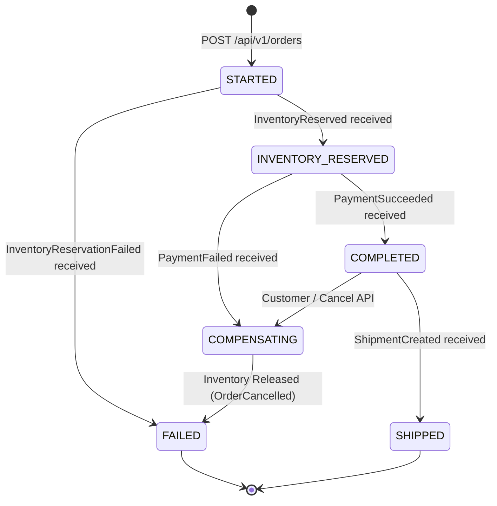

# Distributed Saga Lifecycle & State Machine

## 1. Overview
The order checkout workflow implements an **Orchestrated Distributed Saga** pattern with compensating transactions. `order-service` acts as the central coordinator, tracking state transitions in its persistent `saga_instances` collection.

## 2. Saga State Transition Diagram

## 3. Forward Execution Path
1. **Order Placed**: `order-service` creates order (`PENDING`), creates saga instance (`STARTED`), and emits `OrderCreated` via Outbox.
2. **Inventory Reservation**: `inventory-service` conditionally reserves stock using atomic `$gte`. Emits `InventoryReserved`.
3. **Payment Initiation**: `order-service` transitions saga to `INVENTORY_RESERVED`, marks order `AWAITING_PAYMENT`, emits `PaymentInitiated`.
4. **Payment Processing**: `payment-service` executes charge idempotently. Emits `PaymentSucceeded`.
5. **Confirmation & Shipping**: `order-service` transitions saga to `COMPLETED`, marks order `CONFIRMED`, emits `OrderConfirmed`. `shipping-service` generates tracking number and dispatches `ShipmentCreated`. Order advances to `SHIPPED`.

## 4. Compensating Execution Path
1. **Scenario 1: Insufficient Inventory**:
   - `inventory-service` detects insufficient stock, emits `InventoryReservationFailed`.
   - `order-service` transitions saga to `FAILED`, marks order `CANCELLED` with reason `OUT_OF_STOCK`.
2. **Scenario 2: Payment Failure**:
   - `payment-service` card declined, emits `PaymentFailed`.
   - `order-service` transitions saga to `COMPENSATING`, marks order `CANCELLED`, emits `OrderCancelled` with `inventory_release_required=True`.
   - `inventory-service` consumes `OrderCancelled` and increments available stock back (`$inc`).
