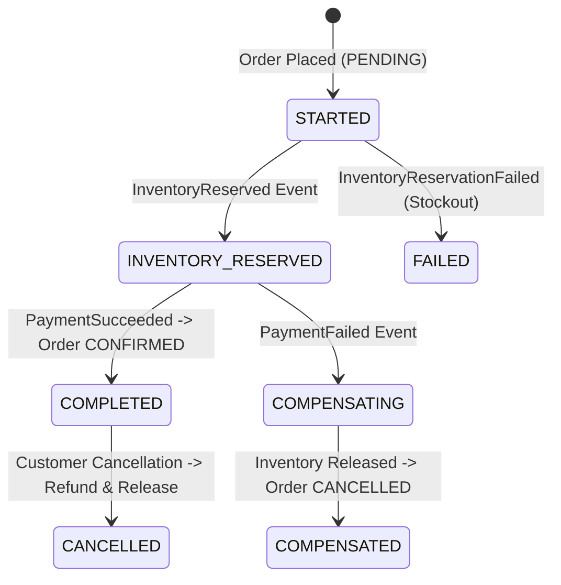

# Engineering Audit: Saga & Distributed Consistency Report

**Auditor**: Distributed Systems Architect  
**Orchestration Pattern**: Orchestrated Saga (Order Service as Orchestrator)  
**State Machine Persistence**: MongoDB `order_db.saga_instances`  

---

## 1. Saga State Transitions & Audit Matrix

---

## 2. Empirical Scenario Verification Results

### Scenario A: Happy Path Fulfillment
- **Inputs**: Cart checkout with 2 units of `prod-101`.
- **Observed Saga Path**: `STARTED` -> `INVENTORY_RESERVED` -> `COMPLETED`.
- **Order Final Status**: `CONFIRMED` / `SHIPPED`.
- **Inventory Concurrency**: `available_quantity` decremented from 49 to 47; `reserved_quantity` and `sold_quantity` updated atomically.
- **Verdict**: **PASSED**

### Scenario B: Out-of-Stock Rejection
- **Inputs**: Order checkout requesting 999,999 units of `prod-101`.
- **Observed Saga Path**: `STARTED` -> `FAILED`.
- **Order Final Status**: `CANCELLED` (`cancellation_reason: "Insufficient stock for product prod-101"`).
- **Payment Impact**: Zero payment transactions created.
- **Verdict**: **PASSED**

### Scenario C: Payment Failure & Compensation
- **Inputs**: Order checkout with `payment_method: "card_simulate_decline"`.
- **Observed Saga Path**: `STARTED` -> `INVENTORY_RESERVED` -> `COMPENSATING`.
- **Order Final Status**: `CANCELLED` (`cancellation_reason: "Payment Failed: Card declined"`).
- **Inventory Compensation**: Inventory Service successfully released the reservation back into `available_quantity`.
- **Verdict**: **PASSED**

### Scenario D: Order Cancellation & Refund Compensation
- **Inputs**: `POST /api/v1/orders/{order_id}/cancel` on a paid order.
- **Observed Path**: Initiated refund via Outbox (`RefundInitiated` -> Payment Service -> `RefundSucceeded`), restored inventory, marked order `CANCELLED`.
- **Rejection of Delivered Orders**: Cancellation endpoint explicitly validates order status; delivered or already cancelled orders return HTTP 400.
- **Verdict**: **PASSED**

### Scenario E: Idempotency Key Enforcement
- **Inputs**: Two simultaneous `POST /api/v1/payments` with the identical idempotency key `audit-key-...`.
- **Result**: The second invocation returned the original transaction document without double-charging the card.
- **Verdict**: **PASSED**
